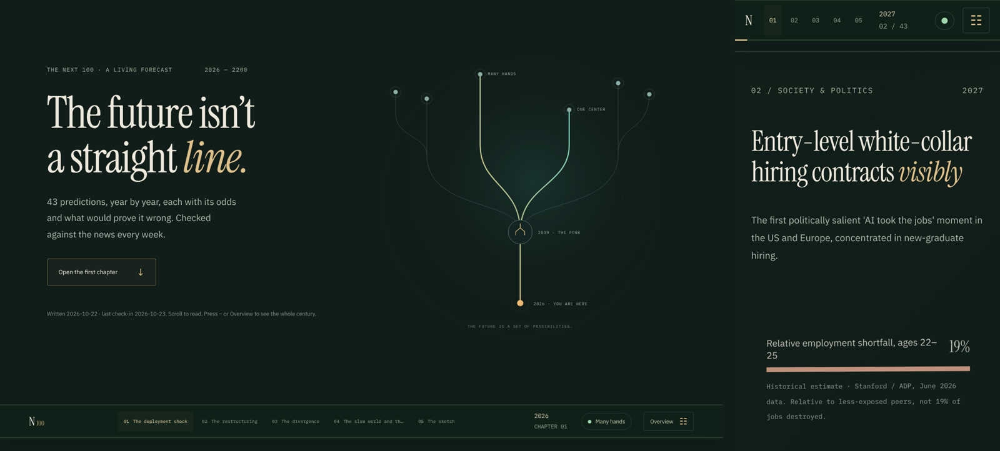
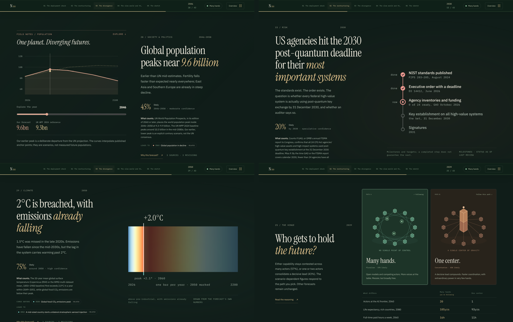
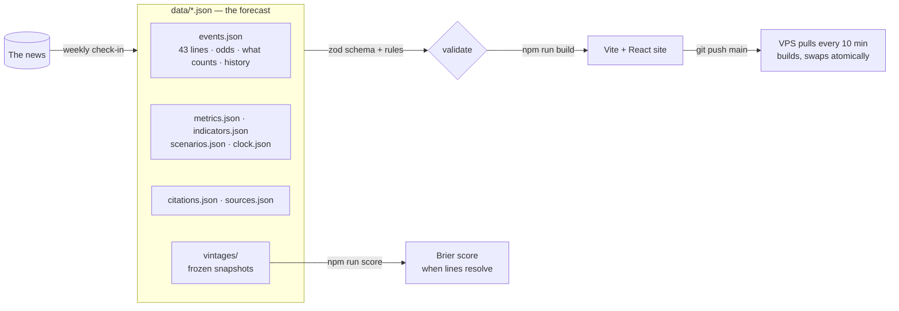

# The Next 100

**A living, self-grading forecast of humanity from 2026 to 2200.** Forty-three dated predictions, each with its odds, what would prove it wrong, and the sources behind it. Every week a check-in reads the news against the forecast, revises it in public, and grades the lines whose time has come.

**Read it: [thenext100.duckdns.org](https://thenext100.duckdns.org)**



## What you're looking at

The site is a book you scroll. Five chapters, one page per prediction, and a fork in 2039 where the future splits between *many hands* and *one center* — pick a path and every number after it follows your choice. Each page shows one figure drawn from the forecast's own data, never decoration: a metric across the century with the UN's projection dotted beside it, a ladder of what has to happen first with what's already done, warming stripes one bar per year, or a field of 100 futures.



Below the book sits the evidence: the metrics, the odds of flourishing on each path, seven leading indicators that say which path we're on, the track record, and every revision ever made with its reason and sources.

## How it works



Three rules make it a forecast rather than an essay:

1. **Every line says what counts.** A `resolution.test` written in advance, a `timing` (around a year, by a deadline, inside a window, or through a date), and signals a check-in can actually search for.
2. **Every change is logged with a source.** Editing a line appends a `history` entry with the URL that was opened. No source, no change. Nothing is ever rewritten or deleted from history.
3. **The original odds are frozen.** `data/vintages/` holds a snapshot of every number after each check-in. When a line resolves it is scored against the earliest vintage that holds that question — the forecast cannot quietly move the goalposts.

## Anatomy of a line

```jsonc
{
  "id": "fusion-net-grid",                 // permanent, kebab-case
  "year": 2034, "timing": "around",        // around · by · window (year–yearEnd) · through
  "domain": "energy",
  "title": "Fusion delivers net electricity to a grid",
  "summary": "A symbolic milestone. …",    // one or two sentences, the forecast's voice
  "detail": "…",                            // the reasoning
  "probability": 0.65, "confidence": "moderate",   // tiers: high ≥ .70 · moderate .45–.70 · speculative < .45
  "resolution": { "test": "A fusion plant delivers more electricity to a grid over a full year than it draws, metered; a demonstration export does not count.", "version": "2026-10-24" },
  "signals": ["A fusion plant signs a power-purchase agreement and delivers", "…"],
  "leadsTo": ["labor-cost-irrelevant", "geoengineering-unilateral"],
  "hero": { "text": "Net +", "label": "electricity to a grid, from fusion", "effect": "sun",
            "ladder": [{ "label": "Scientific gain (NIF)", "state": "done", "note": "gain 4.1, April 2025" }, "…"] },
  "history": [{ "date": "2026-10-23", "change": "detail: 'net electricity' defined", "reason": "…", "sources": ["https://…"] }]
}
```

The full field reference is in [docs/data-model.md](docs/data-model.md).

## Run it

```bash
npm ci
npm run dev          # http://localhost:5173
npm run build        # validates the data, typechecks, builds dist/
npm run qa:book      # structural tests: one page per line, anchors resolve, figures render
npm run score        # the track record (empty until the first lines resolve in 2027)
```

Headless browser checks for layout, overflow and console errors on desktop and phone are in [`qa/`](qa/README.md).

## Challenge the forecast

That's the point of publishing it. Three ways in, from lightest to heaviest:

- **[Open an issue](https://github.com/GrimFandango42/the-next-100/issues/new/choose)** — *Challenge a forecast* (a date, a probability, a framing, with a source) or *Propose a line* (something the forecast is missing).
- **Edit `data/`** and open a pull request. The validator and the tests run on every PR once `.github/ci.yml` is moved into `.github/workflows/` (one step the repo owner does from the desktop). Follow [CONTRIBUTING.md](CONTRIBUTING.md): a `history` entry with the URL you opened, the forecast's voice, no rewriting of history.
- **Run the check-in yourself.** [`CHECKIN.md`](CHECKIN.md) is the protocol; [`SOURCES.md`](SOURCES.md) is the registry of what to read and how to judge it. In Claude Code, `/checkin` runs it end to end. Any model or agent starts with [`ONBOARDING.md`](ONBOARDING.md).

## The method, in one paragraph

Three forces drive the forecast: AI compounds while institutions lag; demographic decline is the slowest, most certain force; and whether the most capable systems end up in a few hands or many is the hinge on which the back half of the century turns. Odds are judgments, not measurements, and the site says so once, in the method, rather than on every page. A 100-year forecast is reliably wrong in its details; the shape is the claim, and the point of this site is to find out, in public, how wrong it was.

## Repo map

| Path | What |
| --- | --- |
| `data/` | The forecast. Plain JSON, schema-checked. `vintages/` are frozen snapshots; `citations.json` is every cited URL with publisher, title and date. |
| `src/` | The site: `StoryJourney.tsx` (the book), `Figure.tsx` (the data figures), `Exhibit*.tsx` (stage explainers), `WorldState.tsx` and `Sections.tsx` (the evidence). |
| `scripts/` | `validate`, `checkin-brief`, `checkin-log`, `vintage`, `score`, `sources-check`. |
| `qa/` | Node tests and Playwright sweeps. |
| `docs/` | [Data model](docs/data-model.md), [architecture](docs/architecture.md), screenshots, and past reviews. |
| `deploy/` | Caddy site block and the VPS update timer. Pushing to `main` is the deploy. |

## License

Code is MIT. The forecast itself — everything under `data/` — is [CC BY 4.0](data/LICENSE): quote it, fork it, grade it, with attribution.
