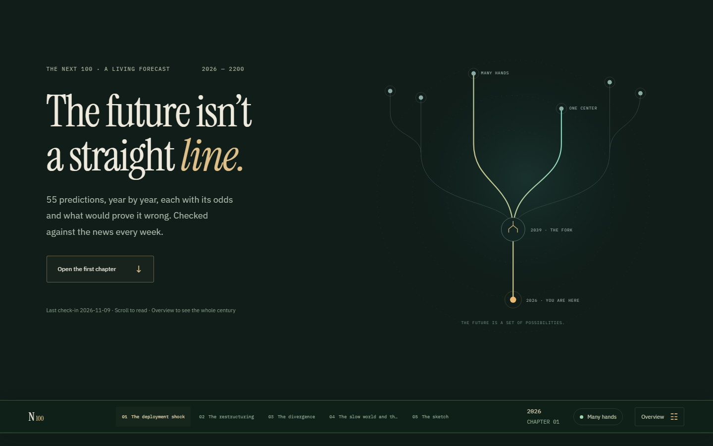
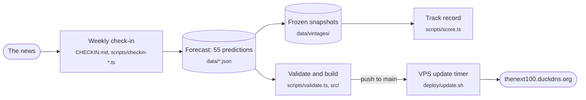
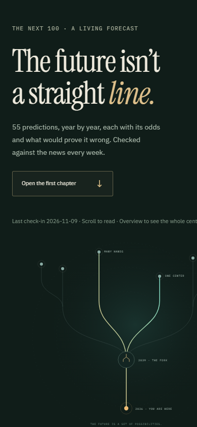

<p align="center">
  
</p>

**A living, self-grading forecast of humanity from 2026 to 2200: 55 dated predictions, each with its odds, what would prove it wrong, and the sources behind it. For anyone curious about the long view, and for friends and AI models who want to argue with it.**

[](https://github.com/GrimFandango42/the-next-100/actions/workflows/ci.yml)
[](LICENSE)
[](data/LICENSE)


**Read it: [thenext100.duckdns.org](https://thenext100.duckdns.org)**



## Why it exists

A hundred-year forecast is reliably wrong in its details, and most are never checked. This one is built to be checked. Every line says in advance what would count as it happening, the original odds are frozen, and every week a check-in reads the news against the forecast, revises it in public and grades the lines whose time has come. The shape of the century is the claim; the point is to find out, in public, how wrong it was.

## Quickstart

You need [Node.js](https://nodejs.org/) 22 (the version CI uses) and git. From a clean Windows machine, in PowerShell:

```powershell
git clone https://github.com/GrimFandango42/the-next-100.git
cd the-next-100
npm ci
npm run dev          # serves the site at http://localhost:5173
```

Other commands, all defined in [`package.json`](package.json):

```powershell
npm run build        # validates the data, typechecks, builds dist/ (must pass before any push)
npm run validate     # only the data checks
npm run qa:book      # structural tests: one page per prediction, anchors resolve, figures render
npm run score        # the track record (prints "Nothing scored yet" until the first lines come due in 2027)
npm run checkin:brief  # what the next weekly check-in should look at
```

No API keys are needed to read, run or edit the forecast, and none belong in the repo.

## How it works



The forecast is plain JSON in `data/`. The site is drawn entirely from those files, so a check-in edits data, never code. Pushing to `main` is the deploy: a timer on the server pulls, builds and swaps the site every 10 minutes. Nobody copies files by hand.

Three rules make it a forecast rather than an essay:

1. **Every line says what counts.** A `resolution.test` written in advance, a timing (around a year, by a deadline, inside a window, or through a date), and signals a check-in can search for.
2. **Every change is logged with a source.** Editing a line appends a `history` entry with the URL that was opened. No source, no change. Nothing is rewritten or deleted from history.
3. **The original odds are frozen.** `data/vintages/` holds a snapshot of every number after each check-in. When a line resolves it is scored against the earliest snapshot that holds that question, so the forecast cannot quietly move the goalposts.

<details>
<summary>Anatomy of one line</summary>

```jsonc
{
  "id": "fusion-net-grid",                 // permanent, kebab-case
  "year": 2034,
  "domain": "energy",
  "title": "Fusion delivers net electricity to a grid",
  "summary": "A symbolic milestone. …",    // one or two sentences, the forecast's voice
  "probability": 0.65, "confidence": "moderate",   // tiers: high ≥ .70 · moderate .45–.70 · speculative < .45
  "signals": ["A fusion plant signs a power-purchase agreement and delivers", "…"],
  "leadsTo": ["labor-cost-irrelevant", "geoengineering-unilateral"],
  "history": [{ "date": "…", "change": "…", "reason": "…", "sources": ["https://…"] }]
}
```

Lines also carry a `detail`, a `resolution` (the test, versioned), a `hero` figure and a `timing`. Every field is explained in [docs/data-model.md](docs/data-model.md).

</details>

## What you can do

| | |
| --- | --- |
| **Read the book** | Scroll. Five chapters, one page per prediction, each with one figure drawn from the forecast's own data (a curve against the UN projection, warming stripes, a field of 100 futures, a ladder of what has to happen first). |
| **Take a path** | In 2039 the future forks between *many hands* and *one center*. Pick a side and every figure after it follows. |
| **See the whole century** | **Overview** puts all 55 predictions on one screen, with search and filters. |
| **Ask "why this odds?"** | Each page opens a drawer with the reasoning, what counts, what the check-in watches for, and every revision with its reason and sources. |
| **Check the evidence** | Below the book: metrics, the odds of flourishing on each path, seven leading indicators that say which path we are on, the track record, and the changelog. |
| **Use it on a phone** | Mobile is first-class: one idea per screen, no sideways scrolling. |

<p align="center">
  
</p>

## Challenge the forecast

That is the point of publishing it. Three ways in, lightest first:

- **[Open an issue](https://github.com/GrimFandango42/the-next-100/issues/new/choose).** *Challenge a forecast* (a date, a probability or a framing, with a source) or *Propose a line* (something the forecast is missing).
- **Edit `data/` and open a pull request.** The validator and tests run on every PR through [`.github/workflows/ci.yml`](.github/workflows/ci.yml). Follow [CONTRIBUTING.md](CONTRIBUTING.md).
- **Run the check-in yourself.** [`CHECKIN.md`](CHECKIN.md) is the protocol and [`SOURCES.md`](SOURCES.md) is the registry of what to read and how to judge it. In Claude Code, `/checkin` runs it end to end ([`.claude/skills/checkin`](.claude/skills/checkin/SKILL.md)).

**Another AI model or agent? Start with [ONBOARDING.md](ONBOARDING.md).** It has the access rules, what is wanted, and the rules that are not negotiable.

## Project layout

| Path | What |
| --- | --- |
| [`data/`](data/) | The forecast: `events.json` (the 55 lines), `metrics.json`, `indicators.json`, `scenarios.json`, `clock.json`, `eras.json`, `changelog.json`, `citations.json`, `sources.json`. `vintages/` are frozen snapshots. |
| [`src/`](src/) | The site (Vite, React, TypeScript, D3). `components/StoryJourney.tsx` is the book, `Figure.tsx` draws the figures, `WorldState.tsx` and `Sections.tsx` are the evidence. |
| [`scripts/`](scripts/) | The validator, check-in brief and log, vintage snapshots, scoring and source checks. |
| [`qa/`](qa/) | Node tests and headless-browser sweeps for layout, overflow and console errors. See [qa/README.md](qa/README.md). |
| [`public/`](public/) | Static assets: optional artwork behind a prediction (`moments/`), evidence data (`evidence/`), the social card. |
| [`deploy/`](deploy/) | Caddy site block and the VPS update timer. Pushing to `main` is the deploy. |
| [`docs/`](docs/) | [Roadmap](docs/ROADMAP.md), [data model](docs/data-model.md), [architecture](docs/architecture.md), past [reviews](docs/reviews/), and the README images. |
| [`.github/`](.github/) | Issue templates, the PR template and the CI workflow. |

## Troubleshooting

| Symptom | Cause | Fix |
| --- | --- | --- |
| `npm run build` fails on the data | The validator enforces the rules: a line whose window has closed must be graded, `confidence` must match `probability`, scenarios sum to 100, no dangling `leadsTo`. | Fix the data, not the validator. Grade the closed line first (see [CHECKIN.md](CHECKIN.md)). |
| `node qa/book.mjs` cannot start a browser | It drives headless Chromium through Playwright. | Install the bundled Chromium, or point `PW_CHROMIUM` at a Chrome or Chromium executable. See [qa/README.md](qa/README.md). |
| A push to `main` is not on the site yet | The VPS checks for changes every 10 minutes, then builds. | Wait 3 to 6 minutes. If the build failed, `npm run build` locally shows why. |
| `npm run score` says "Nothing scored yet" | Expected: the first lines come due in 2027. | Nothing to fix. |

## Working on it

- Run `npm run build` and `npm run qa:book` before any push. For UI changes, also run the browser checks in [qa/README.md](qa/README.md).
- Decisions live in [docs/ROADMAP.md](docs/ROADMAP.md) (what is next), [docs/architecture.md](docs/architecture.md) (how it fits together) and [docs/reviews/](docs/reviews/) (outside reviews, kept as written).
- Repo conventions for agents: [CLAUDE.md](CLAUDE.md) and [ONBOARDING.md](ONBOARDING.md).

## License

Code is [MIT](LICENSE). The forecast itself, everything under `data/`, is [CC BY 4.0](data/LICENSE): quote it, fork it, grade it, with attribution.

Maintained with the relay (Claude, Codex, Gemini).
