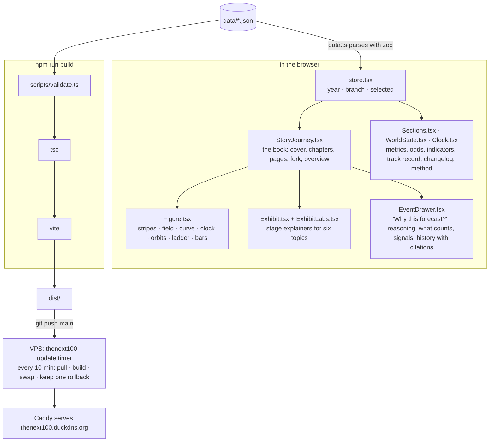

# Architecture

One static site, one data folder, one deploy path. No backend, no database, no accounts.

## The reading model

Scroll is the only way to read. The reader strip at the top shows where you are (chapter, year, page n of 43) and the path you're following; **Overview** (or the `−` key) opens the whole century on one screen with search and a filter. There is deliberately no second navigation: no page-turn links, no tours, no autoplay. See `ONBOARDING.md` rule 5 before adding UI.

`StoryJourney` renders one `<section data-story-stop>` per cover, chapter, page and ending. An `IntersectionObserver` picks the section nearest the viewport centre and sets `active` and the store's `year`; the figures and the fork read `branch` from the store, so flipping the path on the fork page (or the pill in the strip) re-renders every branch-aware figure after it.

## Styling

`src/styles.css` holds the tokens (`:root`) and the evidence section; `src/story.css` holds the book; `src/components/exhibit.css` the explainers. Domain colours live in `src/schema.ts` (`DOMAIN_META`). Dark is the design; a light scheme exists for the evidence section only.

## Scripts

| Script | Does |
| --- | --- |
| `validate.ts` | Schema + rules: tiers, sums, ids, closed windows graded, versioned tests not silently changed. |
| `checkin-brief.ts` | What the weekly check-in should look at: due lines, live lines and their signals, indicators, metrics to refresh, registry sources, standing queries. |
| `checkin-log.ts` | Appends the changelog entry, bumps `meta.lastCheckin`, writes a vintage. |
| `vintage.ts` · `score.ts` · `scoring.ts` | Freeze and grade. |
| `sources-check.mjs` | Per-source status for the registry and citations (run from a machine with open network). |
| `make-art.mjs` | Optional artwork per line via an image model; never required. |

## Deploy

`deploy/update.sh` runs on the VPS from a systemd timer. If `origin/main` differs from the last deployed commit it pulls, `npm ci`, builds, copies `dist/` to `site.new`, swaps it in atomically and keeps the previous site as `site.old` for rollback. A failed build leaves the live site untouched. Nothing else writes to the server; there are no secrets in the repo and none on the box beyond the SSH key.
