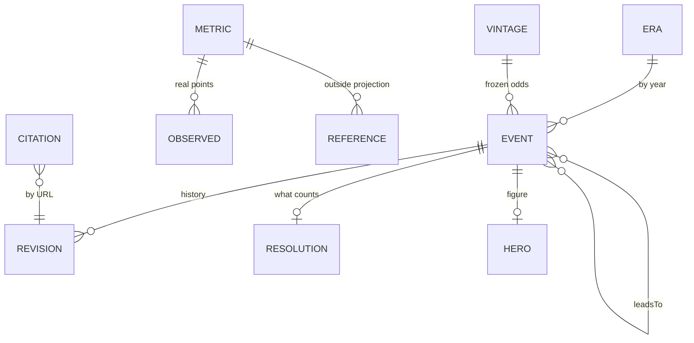

# The data model

Everything on the site is drawn from `data/*.json`. The schema is `src/schema.ts` (zod); `scripts/validate.ts` adds the cross-file rules and runs on every build. This page is the human-readable version.

## `events.json` — the 55 lines

| Field | Type | Meaning |
| --- | --- | --- |
| `id` | kebab-case string | Permanent. Referenced by `leadsTo`, `changelog.touched`, vintages and deep links (`#story-<id>`, `#m-<id>`). Never renamed. |
| `year`, `yearEnd` | int 2026–2200 | The date. `yearEnd` only when `timing` is `window`. |
| `timing` | `around` · `by` · `window` · `through` | How the date reads. `around` = year ± 1 (the default and the grading rule in `CHECKIN.md`); `by` = any time up to the year; `window` = year…yearEnd; `through` = still true at the year. |
| `domain` | `ai` · `bio` · `energy` · `climate` · `space` · `society` · `risk` | Colour and figure defaults come from this. |
| `title` ≤ 90 · `summary` ≤ 280 · `detail` | strings | The claim in plain words; the reasoning. Written in the forecast's voice. |
| `probability` 0–1 · `confidence` | number · `high` · `moderate` · `speculative` | Tiers are enforced: high ≥ .70, moderate .45–.70, speculative < .45. Moving one moves the other. |
| `cornerstone` | bool | The handful of lines the whole forecast turns on. |
| `branch` | `pluralism` · `concentration` | Only when a line exists on one path after the 2039 hinge. |
| `status` · `resolvedOn` | `forecast` · `happened` · `partial` · `early` · `late` · `missed` · `retired` · date | Grading. A resolved line needs `resolvedOn` and a history entry explaining it. |
| `resolution` | `{ test, version, mode?, assessAfter?, source? }` | **What counts.** The test stated in advance. `version` freezes it: changing the text without a new version fails validation. `mode: "scenario"` marks a narrative sketch that is never scored. |
| `signals` | string[] | Concrete things in the news that would move the line. The check-in searches these. |
| `leadsTo` · `relationshipKinds` | ids · `{id: prerequisite|accelerator|related}` | The dependency graph, rendered as "comes before / leads to" chips. |
| `hero` | see below | The one figure on the page. |
| `history` | Revision[] | Every edit, append-only. |
| `evidenceNote` | string | Optional, only where a specific caveat about the sources is worth stating on the page. |
| `adjudication` | `{ outcome 0|1, rationale, sources, definitionVersion }` | Optional, recorded when a line is graded; feeds the score. |

### `hero` — the figure

The page draws one figure from data. Which one is chosen in `src/components/Figure.tsx`, in this order:

| Field present | Figure |
| --- | --- |
| `bars[]` `{label, value, unit?, kind: observed|forecast|reference, note?}` | A scoreboard: measured numbers beside the bet. |
| `ladder[]` `{label, state: done|now|next, note?}` | Milestones in order, with what's already happened. |
| `metric: "warming"` | Stripes, one bar per year to 2200. |
| `metric: "ai-share"` | A field of 100 dots, lit by the share. |
| `metric: "clock"` | Seconds to midnight on a dial. |
| `metric: "off-earth"` | Earth, Moon, Mars, lit when people live there. |
| any other `metric` | The metric's curve across the century, both branches, observed points and any `reference` series. |
| none of the above | A field of 100 dots lit by the line's own probability. |

`num` / `prefix` / `unit` / `text` plus `label` are the big number under the title. `effect` is a legacy hint from the earlier planet renderer and is harmless.

### `history[]` — a revision

`{ date, change, reason, sources[], from?, to? }`. `from`/`to` are set when the change moved the probability, so the track record can see every move. `sources` are URLs that were actually opened; each should have an entry in `citations.json`.

## `metrics.json`

Seven series the figures and the evidence dashboard draw: population, lifespan, ai-share, work-hours, warming, off-earth, frontier-actors. Each has `keyframes` (one path) or `byBranch` (a path per side of the hinge), `format`, optional `scale: "log"`, `observed[]` `{date, value, source}` for real measurements, and `reference[]` `{label, source, points}` for an outside projection to draw beside the forecast (today: UN WPP 2024 on population).

## `indicators.json`

Seven leading indicators of which path we're on, each with a `reading` from −1 (concentration) to +1 (pluralism), a `note`, `lastChecked`, and `sources[]`.

## `scenarios.json` · `clock.json` · `eras.json` · `meta.json`

Four end-states with odds per branch (the unconditional column is weighted by `meta.hinge.pluralismProbability` and must sum to 100). The Doomsday Clock path per branch. Five eras with a thesis, what changes for an ordinary life, and the open question. `meta` holds the hinge probability, the three forces, and the caveat.

## `changelog.json`

One entry per check-in or revision: `{ date, kind, headline, body, touched[], sources[] }`. Written by `npm run checkin:log`.

## `citations.json` · `sources.json`

`citations.json` maps every cited URL to `{ title, publisher, date, tier, status, checked }` so a source reads as publisher · title · date. `sources.json` is the standing registry of what to read per domain and metric, with tiers, the standing search queries and the source rules; `SOURCES.md` is the readable version. `npm run sources:check -- --write` records per-source status.

## `vintages/`

One file per check-in, written by the logger, never edited: every line's title, window, test, probability and status; every indicator reading; the hinge; the scenario odds. `npm run score` grades resolved lines against the earliest vintage holding the same question. `2026-10-22.json` is the forecast as first written, reconstructed from history.
